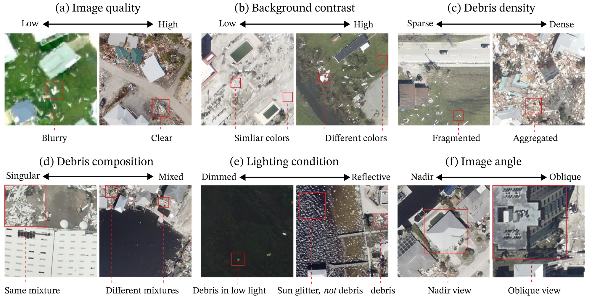
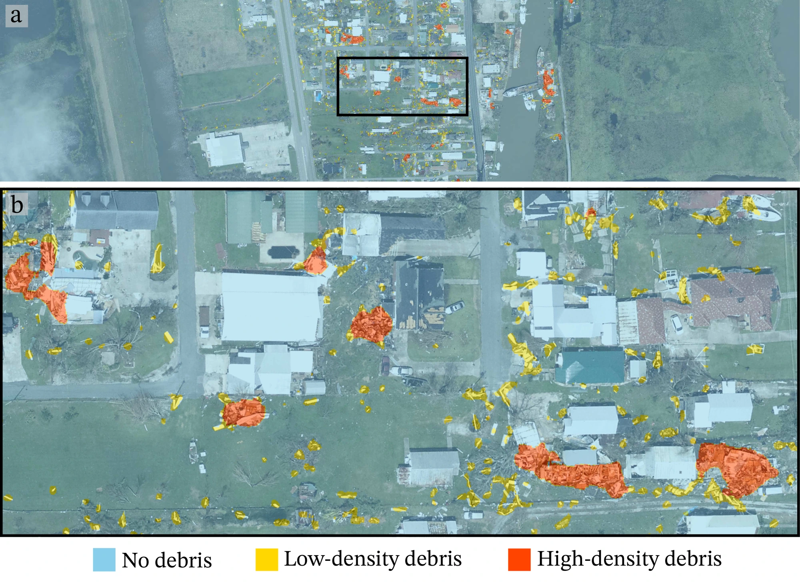
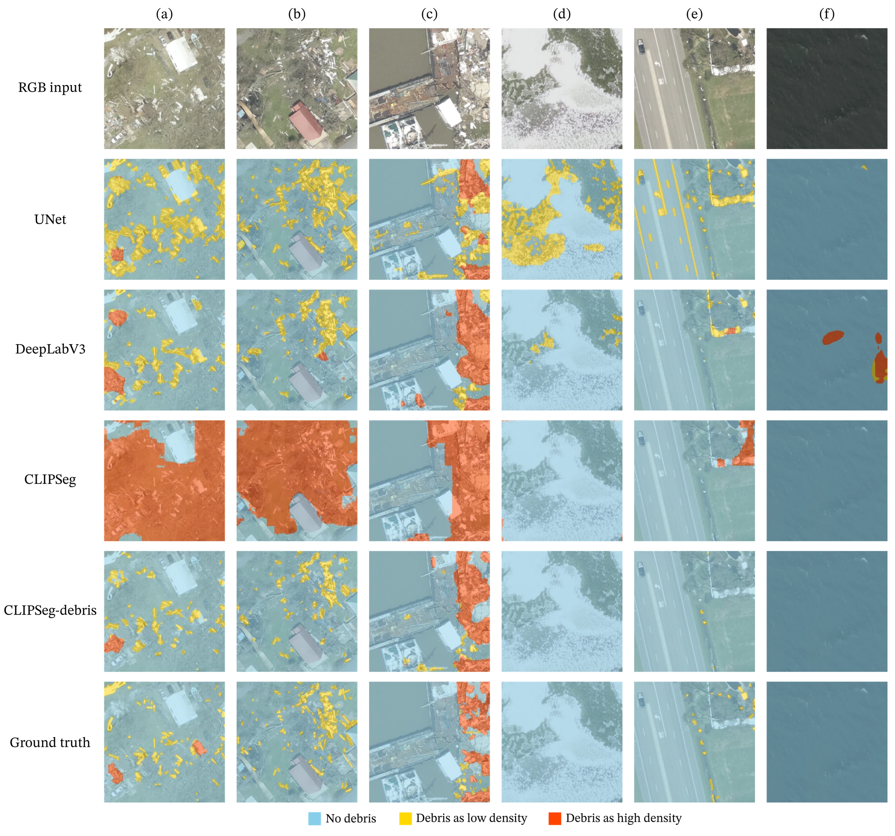

## The problem

After a hurricane, debris removal is one of the largest and slowest parts of recovery, and planning it starts with knowing where the debris is and how dense it is. Aerial imagery arrives within days, but debris looks different from storm to storm and sensor to sensor, and labeled examples are scarce. Models trained on one storm usually fail on the next.

## Approach

- **A dataset built for transfer.** 1,242 tiles of NOAA post-storm aerial imagery (50 m × 50 m tiles at 256 × 256 px) from Hurricanes Ian, Ike, and Ida, labeled as no debris, low-density debris, or high-density debris. A multi-annotator consensus protocol produced the labels; all three annotators agreed on 88.6% of pixels.
- **An honest evaluation.** Training used Ian and Ike; Ida (273 images) was held out entirely, so the test measures generalization to a storm the model has never seen.
- **Adapt a foundation model instead of retraining it.** CLIPSeg with its CLIP ViT-B/16 encoder frozen; only the decoder is fine-tuned (1.2M of 150M parameters). Visual-prompt engineering (blurring and darkening the background) and random mixing of text and image prompt embeddings regularize the decoder. Binary cross-entropy loss, AdamW with a cosine schedule, and mixed precision; about five hours of training on one GPU.

*Why debris is hard to segment: image quality, background contrast, density, composition, lighting, and viewing angle all change from storm to storm and sensor to sensor. Figure from Amini, Liu et al., CACAIE 2025.*

## Results

On the held-out storm, Hurricane Ida:

| Model | Dice | IoU |
| --- | --- | --- |
| **CLIPSeg-debris** | **0.86** | **0.83** |
| DeepLabV3 | 0.82 | 0.79 |
| U-Net | 0.79 | 0.76 |
| CLIPSeg, zero-shot | 0.54 | 0.52 |

- Precision on high-density debris rose to 0.94, from 0.33 zero-shot.
- SAM and Grounded-SAM fail zero-shot on debris: general-purpose foundation models still need domain adaptation.
- Deployed for island-scale mapping: a 10 km² island (4,016 tiles) mapped in 2 minutes 19 seconds on a single GPU.

*Deployment over a large region: (a) predictions across a wide area and (b) a zoomed view of the boxed neighborhood, with low- and high-density debris marked. Figure from Amini, Liu et al., CACAIE 2025.*

*On held-out tiles (a)–(f), U-Net and DeepLabV3 mistake road markings, waves, and open water for debris, and zero-shot CLIPSeg labels whole scenes as high-density debris. CLIPSeg-debris stays closest to the ground truth. Figure from Amini, Liu et al., CACAIE 2025.*

## My role

Co-first author with equal contribution, together with Yuhao Liu, who wrote most of the model and training code. I framed the problem; led the case-study and data design (about 22,500 candidate tiles), the annotation protocol, the evaluation design, and the deployment timing; wrote the paper and made its figures; and prepared the public dataset release on NHERI DesignSafe.

## Open resources

The code (BSD-3 license), model weights, and labeled dataset are public. Links are at the top of this page.
