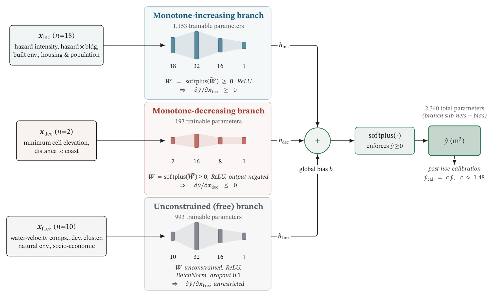
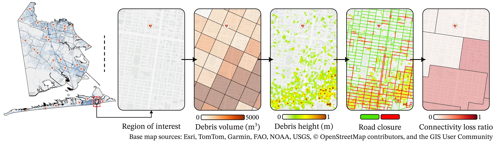
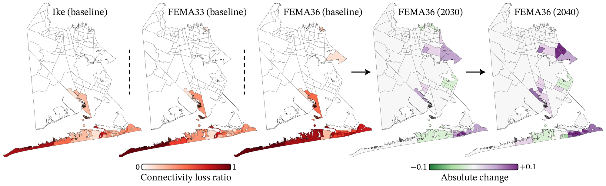

## The problem

Sea levels are rising and coastal land cover is changing, and both change how much debris a hurricane leaves behind. Debris on roads cuts off access to emergency services exactly when they are needed most. How much worse could this get over the next two decades?

## Approach

- **A physics-constrained model.** A monotonic, three-branch neural network (30 inputs, 2,340 parameters) in which 18 features can only increase predicted debris and 2 can only decrease it. Gaussian processes, gradient-boosted trees, and unconstrained networks were tried first and rejected because they extrapolated implausibly under future conditions. Huber loss and a calibration factor, with interpretability and robustness checks: permutation importance, ALE and partial-dependence plots, bootstrap confidence intervals, and seed stability.

*The physics-informed model: a monotone-increasing branch (18 features), a monotone-decreasing branch (2 features), and an unconstrained branch (10 features) are summed and passed through a softplus, for 2,340 trainable parameters. Figure from Amini et al., ASCE Natural Hazards Review (in press).*

- **Scenario coupling.** Storm surge and wave simulations (ADCIRC+SWAN, run by collaborators) for 2020, 2030, and 2040 under SSP5-8.5 sea-level rise, combined with projected land-cover change.
- **Network impacts.** Random-field debris dispersion and 1,000-sample Monte Carlo road-network analysis for each of 9 scenarios across Galveston County (more than 350,000 residents).

## Results

- Debris volumes rise 11–14% by 2040, and loss of access to emergency services rises 9–17%.
- The effects compound: for a storm like Hurricane Ike, +12% surge leads to +14% debris and +17% access loss.
- The debris model reaches R² ≈ 0.66 (95% CI 0.58–0.73).

*A heavily affected neighborhood, from predicted debris volume and height to road closures and the resulting connectivity loss ratio. Figure from Amini et al., ASCE Natural Hazards Review (in press).*

*Connectivity loss ratio for three baseline storms (left) and its projected change for one storm under 2030 and 2040 sea-level-rise and land-cover conditions (right). Figure from Amini et al., ASCE Natural Hazards Review (in press).*

## My role

First author and sole developer of the code: model design and selection, scenario coupling, the Monte Carlo network analysis, and writing. Collaborators ran the storm simulations.

## Builds on

This extends my earlier first-author study in *Reliability Engineering & System Safety* (2023), which introduced random-field debris dispersion coupled with road and bridge fragility and Monte Carlo network analysis over 13,410 road segments, and showed that debris raises loss of access to emergency medical services from 2% to 17%.
