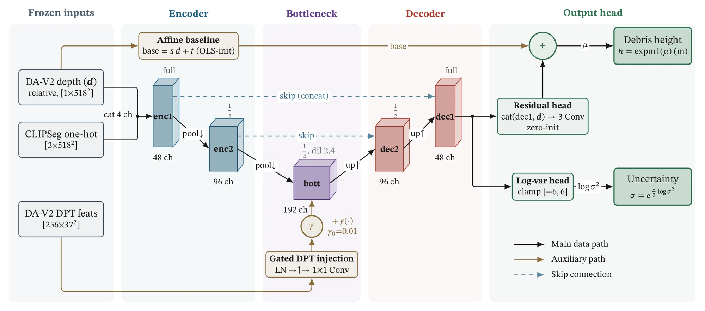
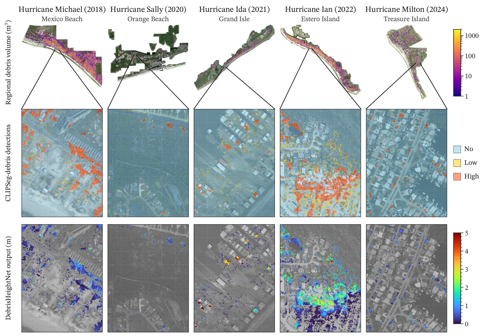
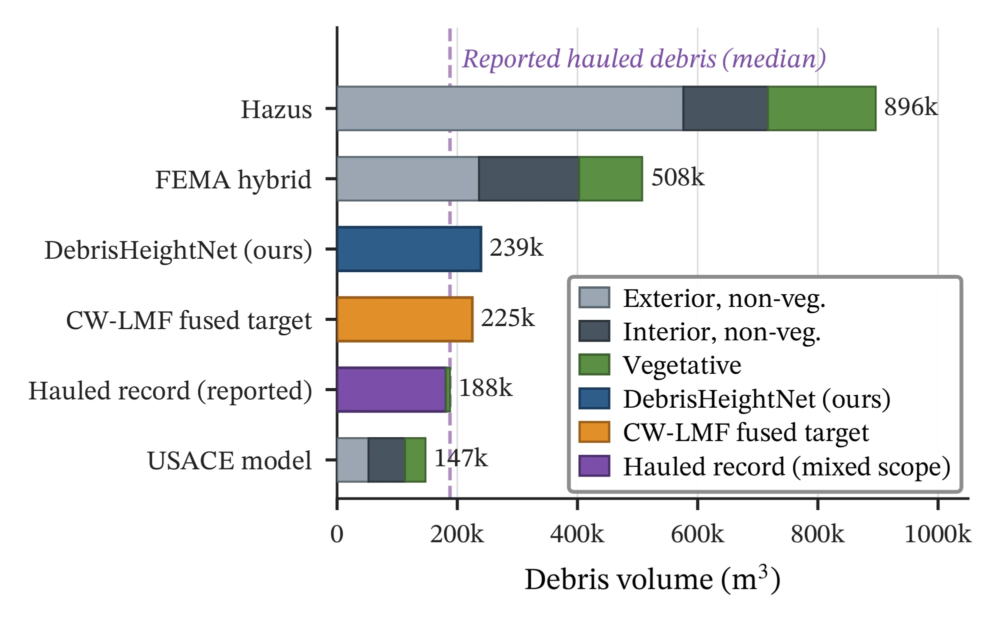

## The problem

Debris removal is planned, contracted, and reimbursed by volume, yet standard forecasting methods such as Hazus and the FEMA hybrid method can over-predict badly. Post-storm LiDAR, which could measure volume directly, is rarely available in time. Can a single aerial image estimate volume well enough to plan with?

## Approach

- **Two frozen foundation models.** Depth Anything V2 (ViT-L) supplies relative depth; the CLIPSeg-debris mask says where debris is and how dense it is.
- **A compact trained head.** A U-Net head with gated feature injection predicts per-pixel debris height in log space, along with its uncertainty: 1.08M trainable parameters, trained in about a day on one GPU.
- **Better training targets.** A new LiDAR and monocular-depth fusion method (CW-LMF) produces dense, debris-only height targets where raw LiDAR is noisy or sparse.
- **A loss built for the decision.** Six terms: Gaussian likelihood, a 2.5× penalty on under-prediction (under-estimating debris is costlier for planners), class weights, gradient matching, per-cell volume consistency, and a variance regularizer.
- **Calibration.** Region-level power-law calibration with leave-one-out validation and 90% prediction intervals.

*Architecture: frozen Depth Anything V2 depth and DPT features, plus the CLIPSeg-debris mask, feed a compact U-Net (48–192 channels) with gated feature injection. The output adds a residual height head to an affine depth baseline, with a separate log-variance head for uncertainty. Figure from Amini, Padgett & Balakrishnan, arXiv 2026.*

## Results

Evaluated on 10 regions from 5 hurricanes across 3 states (about 338 km²):

- **Spearman ρ = 0.87** against UAV structure-from-motion surveys on 1,740 grid cells.
- At Estero Island, the estimate (239,000 m³) is within 30% of the roughly 188,000 m³ actually hauled, where Hazus over-predicts 4.8× and the FEMA hybrid method 2.7×.
- Calibration cuts the median error factor from 2.7× to 1.9×; the held-out height error (MAE) is 0.58 m.
- A useful negative result: training on one clean region generalized better than pooling several regions, in 3 of 4 unseen regions.

*One region per storm, from Hurricane Michael (2018) to Milton (2024): regional debris volume (top), CLIPSeg-debris detections (middle), and DebrisHeightNet height maps (bottom). Figure from Amini, Padgett & Balakrishnan, arXiv 2026.*

*At Estero Island, DebrisHeightNet estimates 239k m³ against 188k m³ actually hauled, while Hazus predicts 896k m³ and the FEMA hybrid method 508k m³. Figure from Amini, Padgett & Balakrishnan, arXiv 2026.*

## My role

First author and sole developer of the research code: problem framing, the target-fusion method, model and loss design, experiments, and writing.
