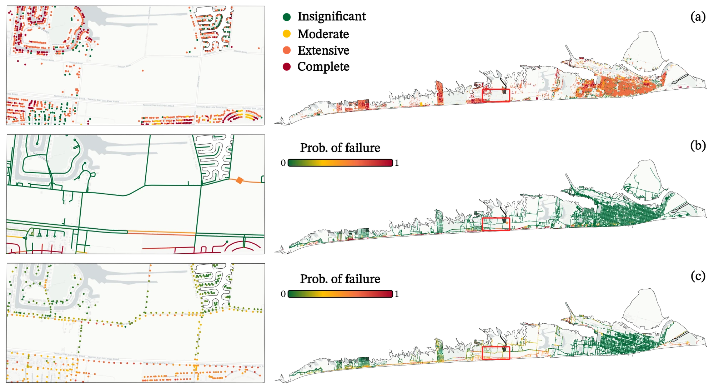
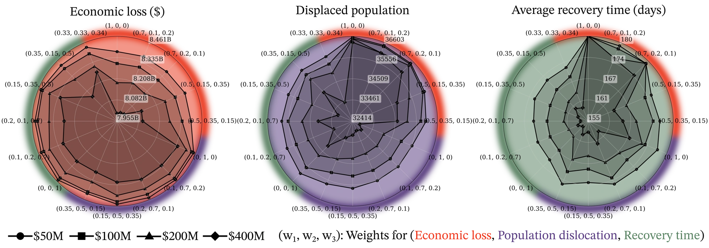
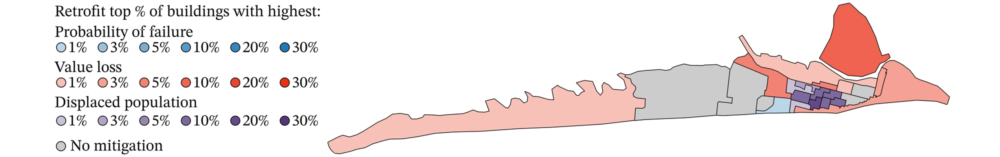

## The problem

Communities facing hurricanes have to decide where to spend limited mitigation budgets, such as retrofitting buildings or hardening power and transportation networks, while accounting for how buildings, infrastructure, people, and the local economy affect one another. Most studies model one piece. This framework connects them.

## Approach

- **Hazard to damage.** Multi-hazard (wind, surge, and wave) building damage with NCSA's IN-CORE platform (pyincore).
- **Infrastructure recovery.** Power and transportation network recovery with NetworkX, PageRank-based repair priority, and parallel Monte Carlo simulation (at least 1,000 samples).
- **People and economy.** Population dislocation and housing recovery, computable general equilibrium (CGE) economics, and Theil-index equity metrics from collaborating teams.
- **Optimization.** Weighted-sum multi-objective binary optimization over 19 mitigation strategies per census tract and 80 scenarios.

*Multi-hazard risk for the 100-year hurricane scenario: (a) building damage states, (b) failure probability of roads and bridges, and (c) failure probability of the power network. Figure from Amini et al., IJDRR 2026 (CC BY).*

*Pareto-optimal solutions for economic loss, displaced population, and average recovery time under budgets of $50M, $100M, $200M, and $400M. Figure from Amini et al., IJDRR 2026 (CC BY).*

*One optimized plan: each census tract retrofits the top 1–30% of its buildings, ranked by failure probability, value loss, or displaced population, or receives no mitigation. Figure from Amini et al., IJDRR 2026 (CC BY).*

## Results

- Baseline scenario: $8.46B in losses, 36,603 people displaced, and a 180-day recovery.
- A $200M mitigation plan cuts expected losses by $192M, displaces about 1,500 fewer people, and shortens recovery by 15 days.
- The most efficient plan is not the most equitable one, and the framework makes that trade-off explicit.

## My role

First of 16 authors. I built the simulation pipeline and recovery code, integrated collaborators' optimization, CGE, and equity components, and led the revision. As the Rice student lead of the Galveston testbed from 2023 to 2025, I coordinated a 38-person group from about 16 institutions and built a 15,865-node power-network model. The testbed datasets are published on NHERI DesignSafe (PRJ-4527).
