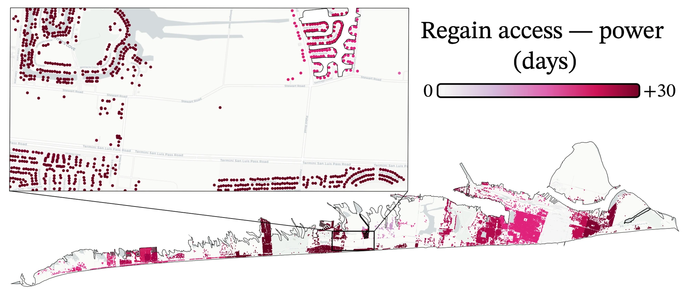

## The problem

IN-CORE (Interdependent Networked Community Resilience Modeling Environment) is NCSA's open-source platform, developed with the NIST Center of Excellence, for modeling how communities withstand and recover from disasters. It lacked a reusable analysis of how an electric power network, and the buildings it serves, recovers after a hazard.

## What I built

- **Network model.** Builds a NetworkX graph of the power network and links each building to it with a KD-tree.
- **Damage and repair.** Samples component damage with Monte Carlo simulation, schedules repairs under crew constraints, and restores components in order of importance, producing restoration curves for buildings.
- **Production quality.** Replaced joblib with `concurrent.futures`, added input validation and sensible defaults, kept the code black-compliant, and wrote a test script.

*Simulated days for each building on Galveston Island to regain power, from the recovery analysis applied to the testbed. Figure adapted from Amini et al., IJDRR 2026 (CC BY).*

## Outcome

Merged into IN-CORE/pyincore-incubator on July 23, 2025 as pull request #21 (+1,417 lines), after code review. The repository's CI runs black, conda builds, documentation builds, and PyPI packaging.

## Context

I was selected by interview for the first IN-CORE Contributor Cohort in 2024, which paired each contributor with an NCSA research software engineer. I also presented *Community Resilience Modeling with IN-CORE* at the NHERI SimCenter Community Roundtable in 2024, as the only graduate-student speaker.
