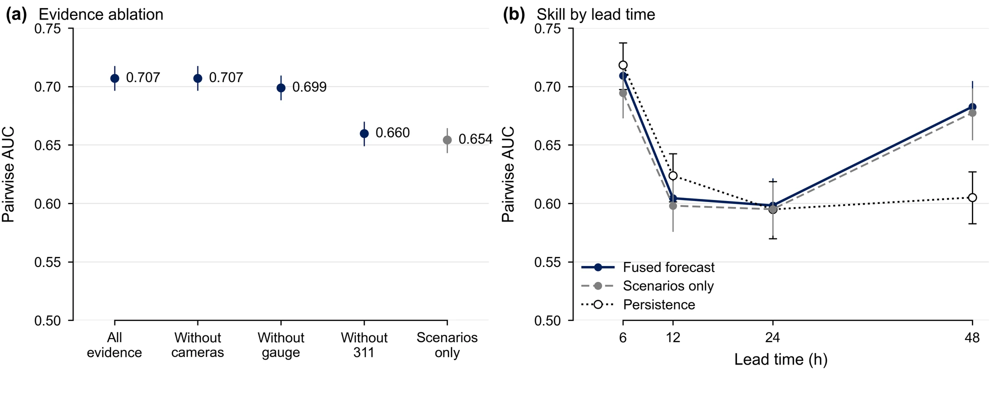

## The problem

During a flood, signals arrive from everywhere: model forecasts, 311 calls, traffic cameras, stream gauges, and navigation apps. Different teams build them, in different formats, with different reliability. OpenSafe.AI, funded by the NSF Responsible Design, Development, and Deployment of Technologies (ReDDDoT) program, aims to combine them into situational awareness that responders can trust.

## Approach

- **Architecture as contracts.** I wrote the system architecture plan (versions 0.1 to 0.4): versioned JSON-Schema message standards, an input/output standard for vision models, modules exposed as Model Context Protocol (MCP) servers, decision records, and a semantic-versioning registry, so that teams can build and ship independently.
- **Schema-validated orchestration.** An orchestrator pilot validates every message against the schemas: 18,004 messages in about 100 seconds per pass.
- **Bayesian fusion.** Flood probabilities from 11 forecast cycles × 160 scenarios are updated with evidence from 311 reports, traffic cameras, gauges, and Waze reports.
- **Vision benchmark.** A 1,070-image benchmark for evaluating camera-based flood detection.

## Results

In a replay of Hurricane Harvey:

- Held-out AUC improved from 0.654 to 0.707, better in all 11 forecast cycles.
- The fused model flagged 738 of 1,286 flood reports a median of 27 hours early.

*Does the evidence help? (a) Held-out pairwise AUC with all evidence (0.707) versus scenarios alone (0.654), and with each data source removed in turn; (b) skill by forecast lead time.*

## My role

Project coordinator and system architect: I coordinate the multi-team effort, authored the architecture and interface standards, and built the orchestration and fusion pilots.
