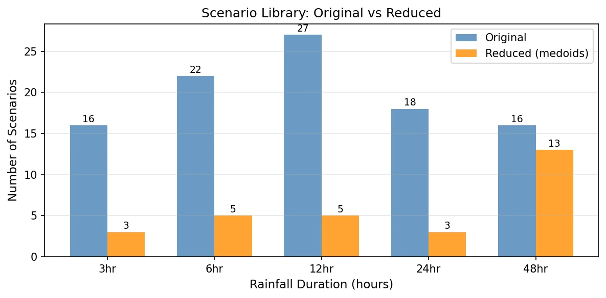
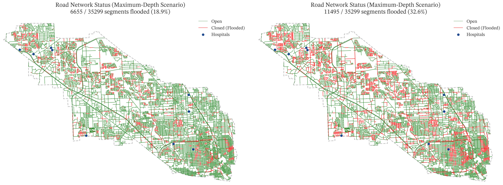

## The problem

Real-time flood warning needs inundation maps in seconds, not the hours a 2D hydraulic model takes to run. A library of precomputed HEC-RAS scenarios can stand in, but 99 full-resolution maps are expensive to store, validate, and search during an event. Which maps actually matter?

## Approach

- **Ingestion at scale.** Read 2D HEC-RAS outputs (HDF5) with h5py and processed rasters with windowed rasterio I/O.
- **Map fingerprints and clustering.** Summarized each map with a 322-feature fingerprint, reduced it with PCA (three components explain 95.4% of the variance), and picked representative maps with duration-constrained k-medoids, plus a coverage model to check what the reduced library still represents.
- **GPU validation.** Compared full-resolution rasters (805 million pixels) with chunked CuPy kernels in 512-row blocks and a CPU fallback: 6–7× faster.
- **Impact analysis.** Modeled flood-driven closures on 35,299 OpenStreetMap road segments and access to 12 hospitals with multi-source Dijkstra.
- **Automation.** Two Python packages with a command-line interface and six YAML configurations; reports generated with python-docx.

*The scenario library before and after reduction, by rainfall duration: 99 maps become 29 representative medoids.*

## Results

- 99 → 29 representative maps (−71%) with a full-resolution RMSE of 0.27 ft, a Jaccard index of 0.994, and F1 ≈ 0.95.
- A 3-hour storm closes 18.9% of roads (access-loss index 0.35); a 12-hour storm closes 32.6% (0.70).

*Open and flooded road segments in the maximum-depth scenario of a 3-hour storm (left, 18.9% of 35,299 segments closed) and a 12-hour storm (right, 32.6%), with hospitals marked.*

## My role

Rice technical lead on the impact side and first author of three technical reports; acknowledged first in the project's final report.
