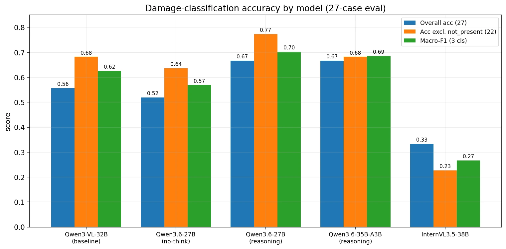
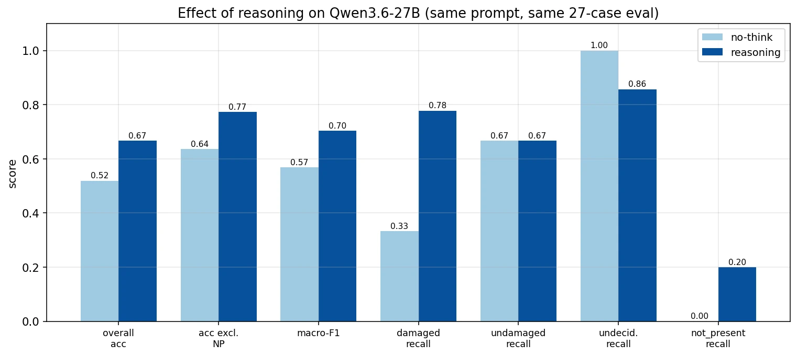
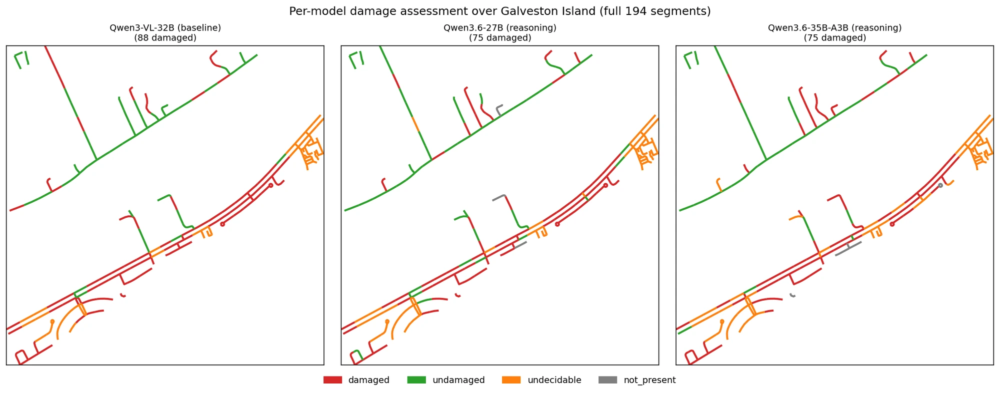

## The problem

After a hurricane, transportation agencies need to know which roads and bridges are damaged or blocked across thousands of square kilometers, quickly, and without a labeling budget. Commercial satellite imagery covers the region within days. The bottleneck is turning terabytes of pixels into per-segment answers.

## Approach

- **Imagery engineering.** Designed the imagery request (26 areas covering 3,353 km²) and built a resumable, checksum-verified transfer tool (multipart ETag/MD5 audits, atomic promotion, HTTP Range resume, bandwidth throttling) to archive 2.1 TB, then traced its throughput limit to disk rather than network.
- **A 37-stage, config-driven pipeline.** Pan-sharpening, OpenStreetMap road segmentation into segments of up to 100 m with stable IDs, pre- and post-event image chips, FFT-based co-registration, VLM classification, and GeoPackage outputs, packaged as a Python library driven by configuration files.
- **Zero-shot classification with open VLMs.** Set-of-mark prompting marks the target segment on each chip. A three-vote majority with early stopping skips the third call whenever the first two agree, cutting model calls by 27–32% with identical outputs.
- **Benchmark before scale.** Compared four open VLMs (Qwen3-VL-32B, Qwen3.6-27B, Qwen3.6-35B-A3B, and InternVL3.5-38B) and designed a 1,000-item human-labeled benchmark with exact inclusion probabilities, spatially blocked splits, and blind dual screening.

## Results

- Best model: addressable accuracy 0.77 and macro-F1 0.70. Reasoning mode, set-of-mark prompting, and co-registration raised damage recall from 0.33 to 0.78.
- Found that a 5,120-token output cap was silently truncating the model's reasoning; lifting it raised accuracy from 0.68 to 0.77.
- Production run: 30,362 road and bridge segments in 3.1 days on two GPUs with vLLM (FP8, data-parallel), against a 5.6-day estimate.
- $0 in API fees, versus an estimated $3.7k–$9.2k for the same run on closed models.
- Satellite-derived debris maps agree with aerial-imagery maps at Cohen's κ = 0.65.

*Damage-classification accuracy and macro-F1 for four open VLMs on the 27-case evaluation. The best configuration reaches 0.77 accuracy on cases where the road is present and 0.70 macro-F1.*

*Same model, same prompt, same 27 cases: turning on reasoning raises damaged-segment recall from 0.33 to 0.78.*

*Labels from three models over the same 194 road segments on Galveston Island: damaged, undamaged, undecidable, or road not present.*

## My role

I lead the satellite-imagery work: I designed and built the pipeline, the benchmark, and the runtime study, and presented the results to the Houston–Galveston Area Council (H-GAC) and NASA.
